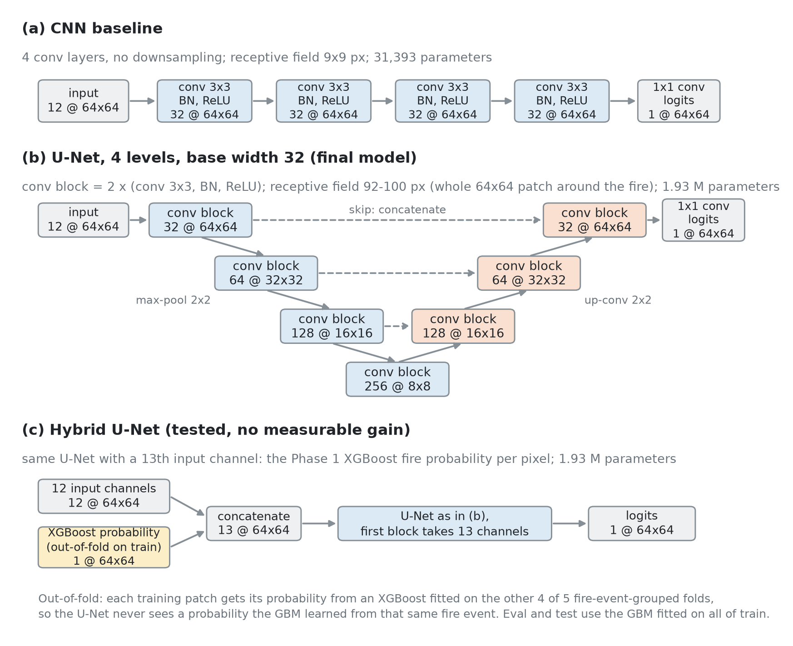

# Next Day Wildfire Spread Prediction

Tabular AML (Phase 1) and spatial deep learning (Phase 2) for predicting next-day fire masks on the [Next Day Wildfire Spread](https://www.kaggle.com/datasets/fantineh/next-day-wildfire-spread/data) dataset (Huot et al., 2022).

## Setup

Python 3.14.

```bash
python -m venv .venv && source .venv/bin/activate
pip install -r requirements.txt
```

On macOS, XGBoost also needs OpenMP: `brew install libomp`.

Tested on macOS 26.6 (Apple M3, 8 GB RAM) with Python 3.14.8: the full pipeline and both notebooks run with no extra steps beyond `libomp`. On this machine the steps took longer than the times below (data 166 s, features 54 s, train 23 min, baselines 98 s, ablation 5 min).

Download the Kaggle dataset and put the 19 `*.tfrecord` files in `data/`.

## Layout

```
data/              raw TFRecords + processed files (not in git)
src/
  data.py          TFRecords -> data/processed/{train,eval,test}.npz, load_split()
  features.py      pixel table + engineered features
  evaluate.py      shared metrics -> reports/results.csv
  eval_utils.py    Phase 2 evaluation helpers used by notebook 03
  train.py         XGBoost / LightGBM tuning + final test run
  baselines.py     persistence, logistic regression, RF, raw XGBoost
  ablation.py      feature-group ablation
  dl_*.py          Phase 2 deep learning (see Phase 2 below)
notebooks/
  01_eda.ipynb         EDA figures
  02_evaluation.ipynb  curves, probability maps, SHAP, error analysis
  03_dl_evaluation.ipynb  Phase 2: recall by distance, event level, dying fires, downwind, saliency
  notes_dataset.md     dataset notes from the paper
docs/
  data_dictionary.md   channels, units, sources, value ranges
  data_quality.md      data quality notes
paper/             IEEE LaTeX report (main.tex, sections/, references.bib, main.pdf)
slides/            presentation deck (slides.tex, slides.pdf)
reports/
  figures/         plots
  checks/          confidence intervals, calibration, learning curves, reproducibility check
  preds/           saved test predictions (not in git)
  dl/              all Phase 2 outputs (see Phase 2 below)
```

## How to run

Approximate runtimes on a laptop CPU:

```bash
python -m src.data        # ~11 s
python -m src.features    # ~30 s
python -m src.train       # ~19 min
python -m src.baselines   # ~80 s
python -m src.ablation    # ~3.5 min
```

Then the notebooks:

```bash
jupyter nbconvert --to notebook --execute --inplace notebooks/01_eda.ipynb
jupyter nbconvert --to notebook --execute --inplace notebooks/02_evaluation.ipynb
jupyter nbconvert --to notebook --execute --inplace notebooks/03_dl_evaluation.ipynb   # Phase 2; needs the saved DL predictions
```

## Build the report and slides

```bash
cd paper && tectonic main.tex     # -> paper/main.pdf
cd slides && tectonic slides.tex  # -> slides/slides.pdf
```

## Results

Test split (1,689 patches, 6.73M labelled pixels, 1.25% fire). Precision / recall / F1 at the decision threshold chosen on the eval split. Bold = best per column.

| Model | PR AUC | ROC AUC | Precision | Recall | F1 | Recall @ 1% FPR | Recall @ 5% FPR |
|---|---:|---:|---:|---:|---:|---:|---:|
| Persistence | 0.106 | 0.633 | 0.357 | 0.273 | 0.309 | 0.273 | 0.273 |
| Logistic reg. (raw) | 0.146 | 0.798 | **0.378** | 0.266 | 0.312 | 0.281 | 0.319 |
| Random forest (raw) | 0.157 | 0.816 | 0.371 | 0.270 | 0.312 | 0.279 | 0.362 |
| XGBoost (raw) | 0.145 | 0.795 | 0.337 | 0.257 | 0.292 | 0.267 | 0.375 |
| XGBoost (tuned, all features) | **0.257** | **0.906** | 0.242 | **0.526** | **0.332** | **0.388** | **0.675** |
| LightGBM (tuned, all features) | 0.248 | 0.903 | 0.242 | 0.520 | 0.331 | 0.384 | 0.671 |

Huot et al. report PR AUC 0.115 (persistence), 0.198 (logistic regression), 0.225 (random forest) and 0.284 (CNN); their LR / RF also see a 3x3 neighbourhood of every channel, so these are reference points, not a like-for-like comparison. More tables: `reports/results_table.md`.

## Phase 2: deep learning

Phase 2 trains whole-patch models (a CNN baseline and a U-Net) on the same splits. It is a separate pipeline:
it reads `data/processed/*.npz` from `src/data.py` but never changes a Phase 1 file or `reports/results.csv`.



### Setup

`torch` is pinned in `requirements.txt` (2.15.0), so the Phase 1 setup above installs it. Training uses the Apple
GPU (MPS) or CUDA when available, and the CPU otherwise. Then check:

```bash
python -m src.data          # once: builds data/processed/{train,eval,test}.npz
python -m src.dl_data       # loaders: shapes, train-only normalisation, labels in {-1, 0, 1}
python -m src.dl_models     # CNN and U-Net output shapes
python -m src.dl_augment    # flips / rotations move the label and turn the wind direction correctly
```

### Code

```
src/
  dl_data.py         normalised PyTorch loaders (clip to train 0.5-99.5 percentile, z-score, fit on train only)
  dl_models.py       CNN (4 conv layers) and U-Net (depth, width; code default 3 levels, width 32;
                     the final model uses 4 levels, see below)
  dl_losses.py       weighted BCE, focal, BCE + Dice; pixels labelled -1 are masked out
  dl_augment.py      training-batch flips / 90-degree rotations that also turn the wind direction `th`
  train_dl.py        training loop, early stopping on eval PR AUC, test scoring
  dl_aug_report.py   augmentation ablation table, paired bootstrap and figure
  dl_arch_diagram.py draws reports/dl/figures/dl_architectures.png from the model code
  dl_gbm_oof.py      fire-event-grouped out-of-fold XGBoost probability maps (13th channel for the hybrid)
  dl_run_architecture_ablation.py  depth / width ablation
  dl_run_channel_ablation.py       drop one input channel group at a time
  dl_run_spatial_crop_ablation.py  train on 32x32 centre crops vs full patches
  dl_run_hybrid_ensemble.py        13-channel hybrid U-Net and probability averaging
  eval_utils.py      evaluation helpers for notebooks/03_dl_evaluation.ipynb
```

### How to run

One run takes about 15-20 min on an Apple Silicon GPU (longer on an 8 GB machine, where loading the data swaps).
Every option is a flag whose default keeps the earlier behaviour. The final Phase 2 model is the U-Net with
4 levels, width 32, focal loss and no augmentation; the code default stays at 3 levels, so pass `--depth 4`:

```bash
python -m src.train_dl --model unet --depth 4 --width 32 --loss focal --seed 0 --name unet_final_s0   # final model (seeds 0-2)
python -m src.train_dl --model unet --loss focal --name unet_focal               # 3-level U-Net, focal loss
python -m src.train_dl --model cnn --name cnn_bce                                # CNN baseline (weighted BCE)
python -m src.train_dl --model unet --loss focal --seed 1 --name unet_focal_s1   # another seed
python -m src.train_dl --model unet --loss focal --aug flip_rot --name unet_focal_aug_flip_rot_s0
```

| Flag | Default | Meaning |
|---|---|---|
| `--model` | `unet` | `cnn` or `unet` |
| `--loss` | `bce` | `bce`, `focal` or `bce_dice` (Phase 2 uses `focal`, chosen by the loss sweep) |
| `--depth`, `--width` | 3, 32 | U-Net levels and base channels |
| `--seed` | 0 | weights, batch order and augmentation draws |
| `--epochs`, `--patience` | 30, 5 | early stopping on eval PR AUC |
| `--lr`, `--batch-size` | 1e-3, 32 | Adam learning rate, batch size |
| `--train-frac` | 1.0 | share of training patches (learning curve) |
| `--aug` | `none` | `none`, `flip`, `rot` or `flip_rot`; training batches only |
| `--aug-fixed-wind` | off | with `--aug`, leave `th` unturned (ablation only) |
| `--name` | model | row name in `results_dl.csv` and checkpoint name |

Each run appends a row to `reports/dl/results_dl.csv`, saves `models/{name}.pt` and `reports/dl/preds/{name}.npz`
(neither in git). The decision threshold is chosen on eval; test is scored once. Summaries and figures:

```bash
python reports/dl/checks/dl_checks.py sweep      # loss sweep
python reports/dl/checks/dl_checks.py validate   # seeds, bootstrap CIs, calibration, overlap, learning curve
python -m src.dl_aug_report --boot                # augmentation ablation
python -m src.dl_arch_diagram                     # architecture diagram
```

### Results

Test split, mean ± standard deviation over seeds 0, 1 and 2. Bold = best per column.

| Model | PR AUC | ROC AUC | F1 | Recall @ 1% FPR | Recall @ 5% FPR |
|---|---:|---:|---:|---:|---:|
| **U-Net, 4 levels, focal (final)** | **0.344 ± 0.007** | **0.935 ± 0.009** | **0.399 ± 0.003** | **0.459 ± 0.003** | **0.783 ± 0.007** |
| U-Net, 3 levels, focal (`--aug none`, Apple M3) | 0.280 ± 0.002 | 0.934 ± 0.002 | 0.346 ± 0.011 | 0.399 ± 0.002 | 0.724 ± 0.008 |
| CNN (weighted BCE) | 0.249 ± 0.010 | 0.878 ± 0.011 | 0.335 ± 0.008 | 0.378 ± 0.009 | 0.653 ± 0.006 |
| XGBoost (Phase 1) | 0.255 ± 0.002 | 0.905 ± 0.001 | 0.330 ± 0.000 | 0.388 ± 0.001 | 0.673 ± 0.001 |
| Huot et al. CNN (reported, for reference) | 0.284 | | | | |

The more of the patch a model sees, the better it scores: the CNN sees 9×9 km and ties XGBoost, the 3-level
U-Net sees 44×44 km (0.280), and the 4-level U-Net's receptive field of 92-100 px (it depends on the pixel's
position) covers the whole 64×64 patch for every pixel within 14 px of the centre, where the fire is (0.344,
above Huot et al.'s 0.284, which comes from a different training pipeline). ROC AUC barely moves, so
the gain is in the rare-fire, low-false-alarm region. The 3- and 4-level seeds ran on different Apple GPUs;
hardware alone moves test PR AUC by up to 0.02. The final U-Net beats XGBoost for every seed on the same fire events (+0.080 to
+0.094), and (seed 0) also on unseen test locations (+0.092). Details: `reports/dl/architecture_ablation_summary.md`,
`reports/dl/checks/loss_sweep.md` and the technical validation section of the paper.

Feeding the U-Net the XGBoost probability as a 13th channel (hybrid, panel c above) brings no measurable gain
(+0.0015 at 3 levels, −0.0025 at 4, one seed each), and an eval-tuned average with XGBoost gives XGBoost zero
weight at 4 levels (`reports/dl/hybrid_ensemble_summary.md`).

**Augmentation** (`--aug`, 3-level focal U-Net, all runs on one Apple M3; mean ± std over seeds 0-2; the final
4-level model keeps `--aug none`):

| `--aug` | Eval PR AUC | Test PR AUC | Recall @ 1% FPR | Recall @ 5% FPR |
|---|---:|---:|---:|---:|
| **none** | 0.222 ± 0.003 | 0.280 ± 0.002 | 0.399 ± 0.002 | 0.724 ± 0.008 |
| flip | 0.224 ± 0.005 | 0.283 ± 0.004 | 0.398 ± 0.005 | 0.728 ± 0.010 |
| rot | 0.226 ± 0.004 | 0.274 ± 0.005 | 0.391 ± 0.010 | 0.718 ± 0.002 |
| flip_rot | 0.221 ± 0.003 | 0.274 ± 0.001 | 0.395 ± 0.002 | 0.713 ± 0.011 |
| flip_rot, `th` not turned (seed 0) | 0.222 | 0.273 | 0.395 | 0.730 |

No augmentation reliably helps: every paired difference over fire events contains zero, and rotations are
slightly worse on test for all three seeds. The final U-Net keeps `--aug none`. Details:
`reports/dl/checks/aug_ablation.md` and `reports/dl/figures/aug_ablation.png`.

### `reports/dl/` layout

```
reports/dl/
  results_dl.csv        one row of test metrics per run (written by train_dl)
  figures/              dl_architectures, loss_sweep, aug_ablation, dl_ci_events, dl_calibration, dl_learning_curve
  checks/
    dl_checks.py        loss sweep and technical validation
    logs/{name}.log     train_dl output per run (per-epoch eval PR AUC)
    runs.csv            metrics of the loss-sweep and validation runs (Kaggle T4)
    loss_sweep.*        loss sweep table, comment, paired bootstrap
    aug_ablation*       augmentation ablation table, comment, paired bootstrap
    seeds.csv, ci_*.csv, calibration*.csv, learning_curve.csv, overlap*.csv, reruns.csv
  preds/                test predictions per run (not in git)
```

## Reproducibility

A fresh clone and a clean venv reproduce `reports/best_params.json` and `reports/ablation.csv` exactly; only the row order of `reports/results.csv` depends on which script runs first.

## Team

| Member | Role | Delivered |
|---|---|---|
| Harshil | Feature engineering, main models, repo | Repo structure, TFRecord reader (`src/data.py`), feature pipeline (`src/features.py`), shared evaluation (`src/evaluate.py`), XGBoost / LightGBM tuning (`src/train.py`), feature-group ablation (`src/ablation.py`), patch orientation fix, methodology section |
| Sushant | EDA, data quality, baselines, ablation | Dataset notes, EDA notebook and figures, data quality audit, raw-channel baselines (`src/baselines.py`), Dataset & EDA section with the ablation write-up, EDA slides |
| Priyanshu | Literature review, theory, LaTeX | Report LaTeX setup and bibliography, related work and theory sections, confidence intervals, calibration and learning curves (`reports/checks/`), related-work slides |
| Sachin | Evaluation, visualisation, interpretability | Evaluation notebook: PR / ROC curves, probability maps, gain importance and SHAP, downwind check, error analysis, event-level evaluation; results table, results section and slides |
| Piyush | Presentation, README, data dictionary | Data dictionary, README, presentation deck, introduction and conclusion, final proofread |
